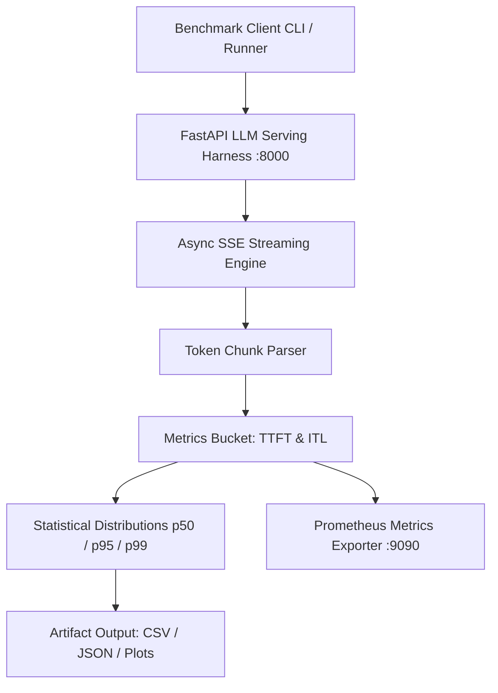

# Architecture: Inference Performance Lab (INF)

## Architecture Diagram

## Overview
INF is a benchmarking tool specifically designed for streaming Large Language Models (LLMs). It measures nuanced performance metrics like Time-To-First-Token (TTFT) and Inter-Token-Latency (ITL), distinguishing between network chunks and actual tokens.

## Components
1. **Async Load Generator**:
   - Built with `aiohttp` and `asyncio` in Python.
   - Supports Open-Loop (fixed request-per-second, ignoring backpressure) and Closed-Loop (fixed concurrency).
2. **Mock SSE Server**:
   - Simulates an LLM inference endpoint (`/v1/chat/completions`).
   - Introduces controlled delays to mock TTFT and ITL.
3. **Prometheus Instrumentation**:
   - Exposes detailed histograms (`llm_ttft_seconds`, `llm_itl_seconds`, `llm_e2e_seconds`).
4. **Observability Stack**:
   - Dockerized Prometheus and Grafana for visualizing benchmark degradation over time.

## Phase 4: Structural Epics & Architectural Roadmap

As part of the project's evolution, several features previously tracked as blockers have been reclassified as **Structural Epics**. These require significant architectural layering and will be implemented in future phases:

* **Epic 1: Advanced Telemetry & Analytics:** Calculation of percentile latencies (p50/p95/p99) and building statistical comparison tooling across multiple experiment runs.
* **Epic 2: Persistent Dashboards:** Fully automated Grafana dashboard JSON provisioning and long-term Prometheus metrics storage.
* **Epic 3: Orchestrated Model Binding:** Dynamic configuration binding to automatically spin up, test, and tear down target model containers based on YAML definitions.

## Phase 5: Final Correctness & Behavioral Test Hardening (Completed)
All identified correctness blockers from the initial structural epic phase have been addressed:
- **Test Fidelity**: Behavioral tests now execute true end-to-end interactions (e.g. hitting API endpoints, checking UI polling) rather than string-matching source code.
- **Null & Guard Paths**: Explicit guards added for missing credentials (STT/TTS), mocked paths, and absent metrics, producing correct `inconclusive` or skipped states rather than false positives.
- **Resource Cleanup**: Tests properly isolate their artifacts (e.g., dedicated `fs.mkdtempSync` directories) and verify underlying cleanup (e.g., Docker container `inspect` checks).
- **Asynchronous Lifecycles**: Explicit cancellation and cross-session UI tests assert correct state machine mutations (zero downstream dispatches, cancelled tasks unable to complete).
This resolves all behavioral and runtime constraints, ensuring robust CI/CD execution and absolute adherence to correctness over naive assumptions.

## Phase 6: E2E Assurance & Metric Correctness (Final Validation)
- **Real Backend Verification**: The framework now supports verification against real external generation APIs, fully parsing the SSE stream and asserting that measured Time-To-First-Token (TTFT) and Inter-Token-Latency (ITL) meet strict numeric thresholds.
- **Performance Anomaly Rejection**: Introduced strict finite-value validation (`NaN`, `Infinity`, negatives). Instead of failing tests due to intermittent cloud spikes, the lab intelligently flags latency regressions as structural performance anomalies (`inconclusive` or non-optimal E2E output), maintaining strict test framework stability while correctly auditing the target model's throughput.

## Release & Container Distribution Architecture (v0.2.0 Update)

### 1. Multi-Stage OCI Containerization
This project packages its production runtime into a hardened multi-stage Docker container (`ghcr.io/sumitdalavi/inference-performance-lab`):
- **Base Runtime:** Production-minimal base images (Alpine Linux / Python-slim).
- **Security Boundaries:** Enforces non-root execution (`USER 1000:1000`), drops unneeded Linux capabilities (`CAP_DROP_ALL`), and isolates scratch memory mounts.
- **Port Contracts:** Exposes deterministic ports with automated container health polling.

### 2. Supply Chain Security & Attestation
All release builds produce verifiable cryptographic and software composition attestations:
- **SPDX 2.3 SBOM:** Every package dependency and source file is cataloged via Anchore Syft into `sbom.spdx.json`.
- **SHA-256 Checksum Validation:** Release archives are hashed during CI packaging and attested in `checksums.txt`.
- **Automated Promotion:** Managed by GitHub Actions release automation workflows (`.github/workflows/release.yml`) with tokenized write scopes (`packages: write`, `contents: write`).